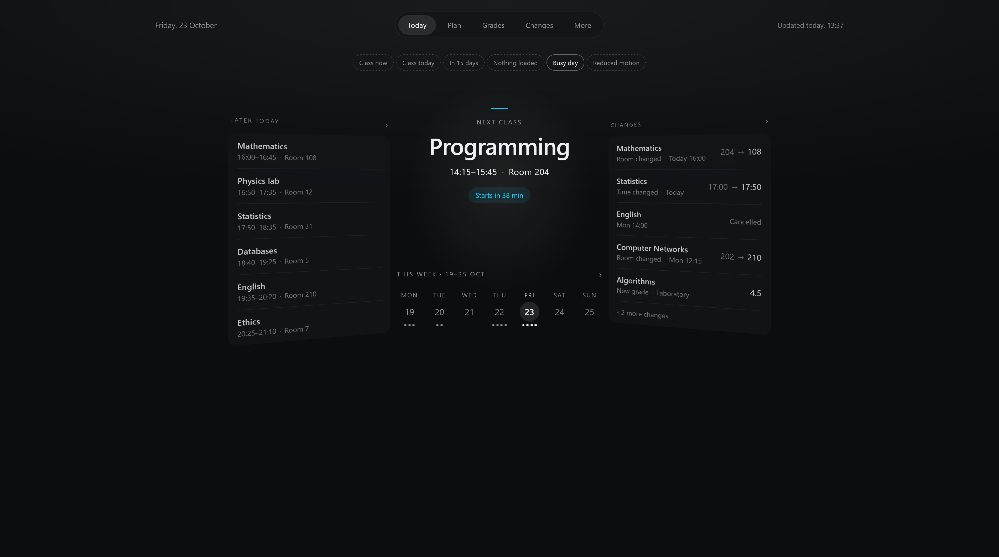
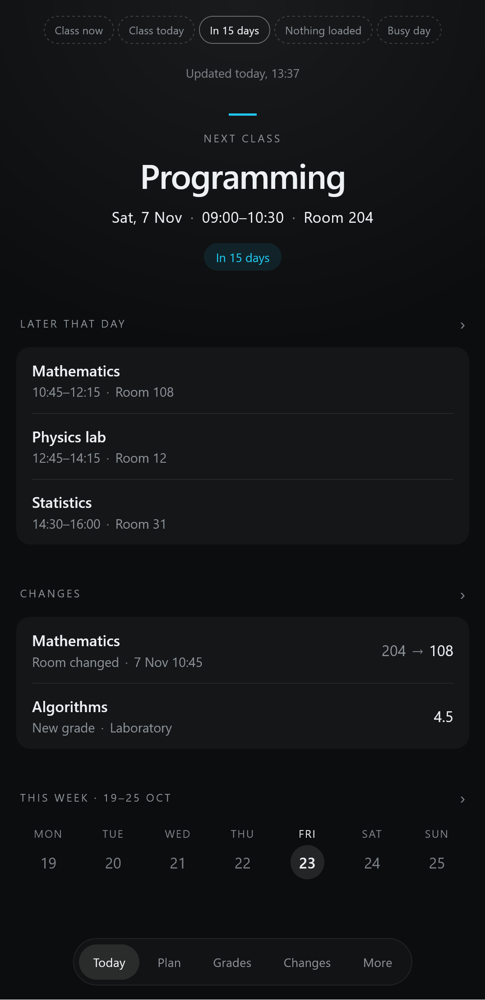
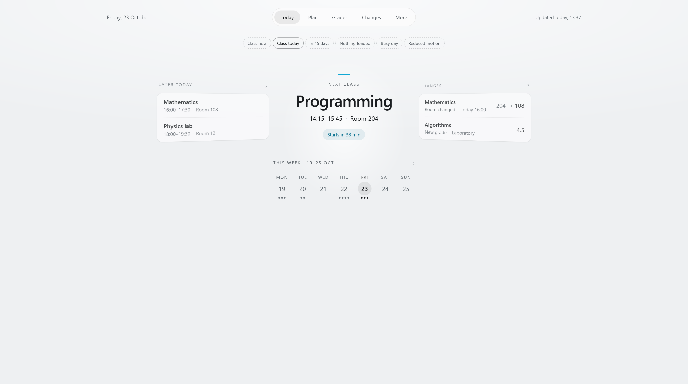
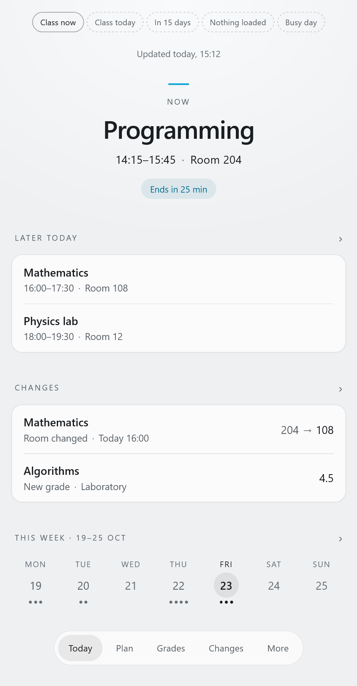

# usoschecker_design

**UI/UX design for the existing [USOS Checker application](https://github.com/a0w-svg/usoschecker-public)**

---

## Today — Dark

| Desktop | Mobile |
|:---:|:---:|
|  |  |

## Today — Light

| Desktop | Mobile |
|:---:|:---:|
|  |  |

